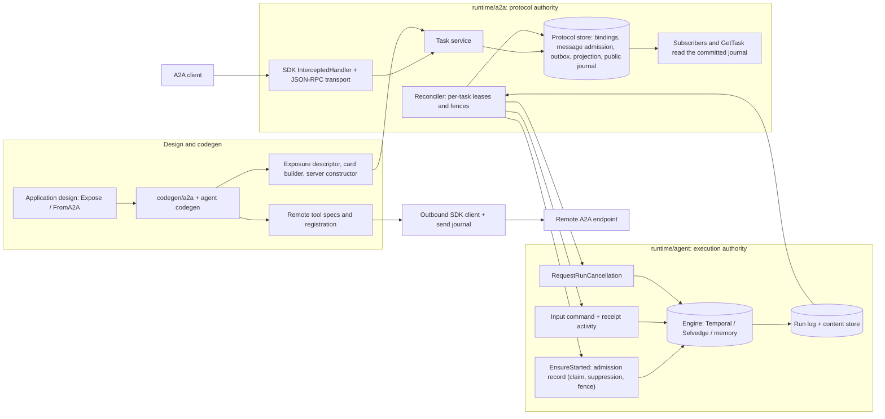
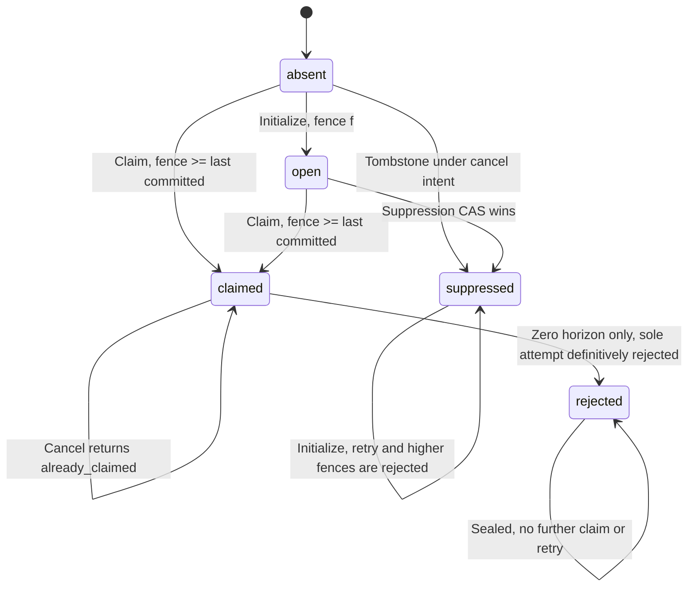
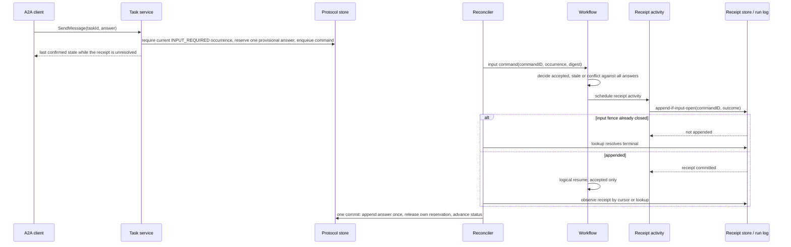
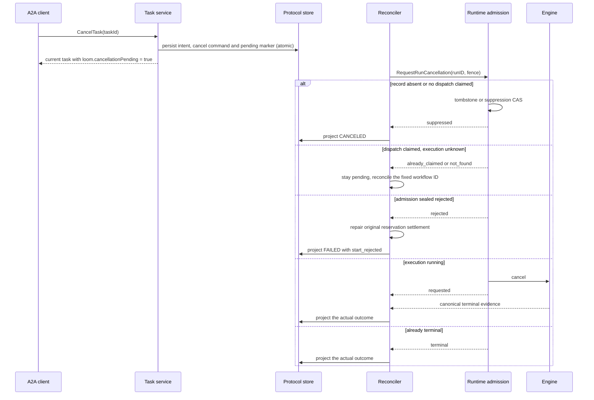
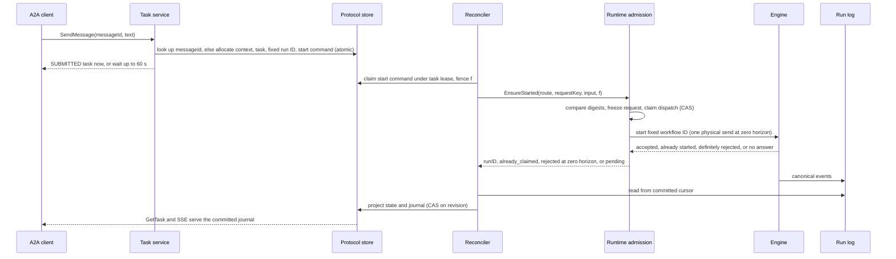
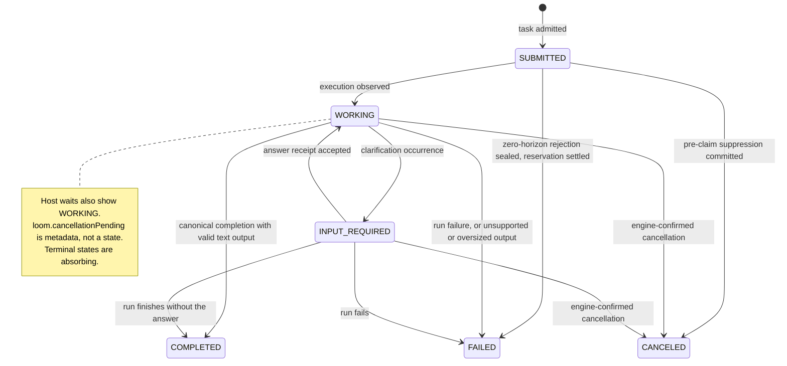
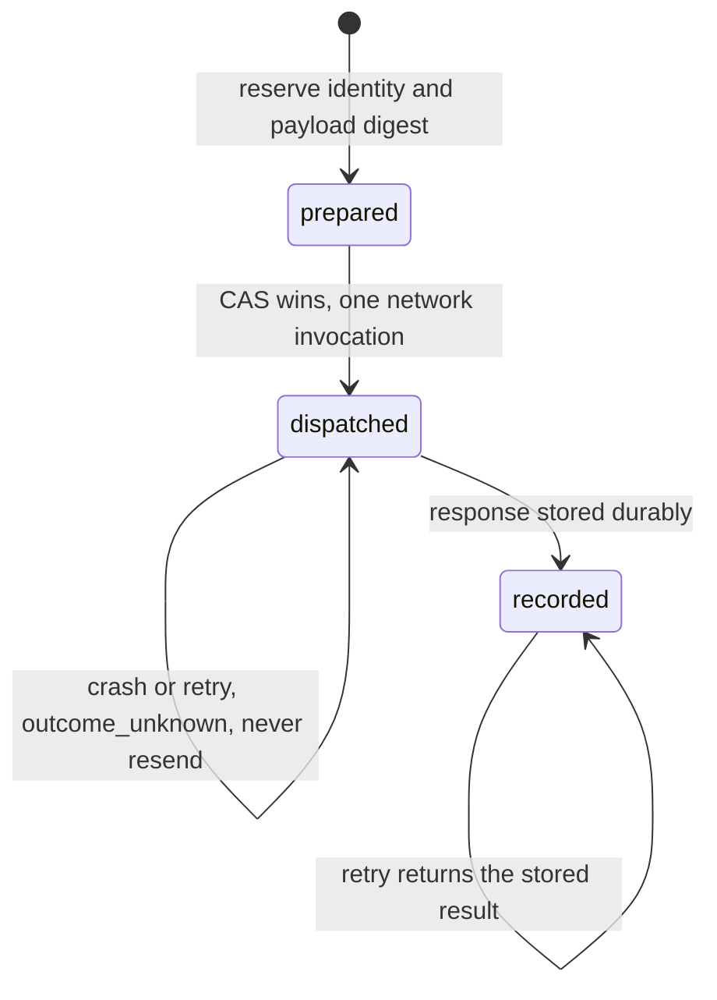

# A2A interoperability design

Status: V1 implementation baseline; bounded concurrency model checked

Updated: 2026-10-27

Scope: Loom-MCP V2; inspected at `4e517d3a`

## Summary

Add a separate A2A adapter that exposes selected Loom agents and consumes remote
A2A agents over A2A 1.0 JSON-RPC/HTTP, using the official Go SDK for wire types,
transport and clients. Loom remains the execution authority. A small durable
adapter store owns protocol identities, accepted messages and public task
projections.

V1 supports text conversations, task creation, retrieval, listing, cancellation,
clarification and SSE task updates. Remote agents are reachable through a Go
client and an explicit `send`, `get_task`, `cancel_task` toolset; remote tasks
keep their own identities and never become Loom child runs. Files, structured
outputs, push delivery and other transports are deferred. Nothing is exposed
merely because an agent or toolset exists.

The design depends on three runtime seams that carry no A2A types: idempotent
admission, acknowledged clarification input and cancellation evidence. Their
concurrency core is checked by a bounded TLA+ model.

## Problem statement

Loom agents compose locally and consume MCP tools, but cannot publish a standard
A2A endpoint or talk to an independent A2A agent. An HTTP wrapper around
`AgentClient.Run` is insufficient: a disconnected caller must recover an accepted
task, duplicate messages must not start new runs, a cancellation must not report
that execution stopped before the runtime confirms it, and public output must
exclude planner messages, tool results and server-only content.

## Goals

- A standard A2A client can discover and use an explicitly exposed Loom agent.
- A Loom agent can send work to an explicitly configured remote A2A agent and
  inspect or cancel its task without holding a tool activity open for its
  lifetime.
- Accepted tasks, answers and results survive gateway replacement when persistent
  stores and a durable engine are configured.
- Agent Cards, generated registrations and wire behavior describe the same
  capability set; existing MCP and local composition contracts stay intact.
- Scope and authorization are checked on every operation, including recovery,
  listing, subscriptions and outbound task references.

## Non-goals

V1 does not implement A2A 0.3 compatibility, REST or gRPC bindings, push
notifications, signed or extended Agent Cards, protocol extensions, binary/URI
or structured-data parts, or live token streaming. Unsupported wire operations
fail explicitly.

V1 does not discover remote agents from model-supplied URLs, turn A2A skills into
tool schemas, publish local tools through A2A, register A2A endpoints in the
MCP/Pulse registry, provide an OAuth issuer or consent UI, cancel remote tasks on
parent closure, or offer cross-framework exactly-once side effects.

## Current state

Names introduced later in this document are proposed APIs.

| Owner | Existing contract | Design implication |
| --- | --- | --- |
| [`dsl/agent.go`](../../dsl/agent.go), [`expr/agent/agent.go`](../../expr/agent/agent.go) | Agents belong to services; `Use` and `Export` declare toolset relationships. | A2A exposure needs an explicit agent declaration, separate from tool exports. |
| [`codegen/agent/generate.go`](../../codegen/agent/generate.go), [`toolset_ownership_resolver.go`](../../codegen/agent/toolset_ownership_resolver.go) | Generated agent packages and deterministically owned shared toolset packages. | Reuse ownership and naming; do not create a second specs owner. |
| [`runtime/agent/runtime/client.go`](../../runtime/agent/runtime/client.go) | `Start` requires an existing session and returns a workflow handle; generated routes can target remote workers. | A gateway submits through the existing route; request lifetime is separate from run lifetime. |
| [`runtime_runs.go`](../../runtime/agent/runtime/runtime_runs.go), [`session/session.go`](../../runtime/agent/session/session.go) | Starts reserve runs with an internally generated attempt ID; terminal session statuses cannot change. | `WithRunID` alone is insufficient for crash-safe re-entry into a pending reservation. |
| [`engine/engine.go`](../../runtime/agent/engine/engine.go), [`run_completion.go`](../../runtime/agent/runtime/run_completion.go) | Query by workflow ID, optional cancel/signal/completion interfaces, canonical completion repair. | Reconcile through runtime/engine contracts, never through a process-local handle. |
| [`runtime_runs.go`](../../runtime/agent/runtime/runtime_runs.go) `CancelRun` | Requires the optional `engine.Canceler`; engine not-found is returned as success. | Not-found cannot be read as canceled or never started; cancellation evidence needs its own seam. |
| [`runtime_runs.go`](../../runtime/agent/runtime/runtime_runs.go) `ProvideClarification`, [`engine/engine.go`](../../runtime/agent/engine/engine.go) | Clarification is a fire-and-forget signal; no update-with-result primitive. | A receipt needs an explicit return path. |
| [`runlog/runlog.go`](../../runtime/agent/runlog/runlog.go) | Ordered, append-only run events, deduplicated by logical event key. | Public projections recover independently of lossy live streams. |
| [`run/snapshot.go`](../../runtime/agent/run/snapshot.go), [`api/types.go`](../../runtime/agent/api/types.go) | Await snapshots and typed clarification/confirmation inputs are distinct. | A free-form remote reply must never approve a tool confirmation. |
| [`runtime/runtime.go`](../../runtime/agent/runtime/runtime.go), [`agent_tools_config.go`](../../runtime/agent/runtime/agent_tools_config.go) | Activity-backed tool execution is distinct from child-workflow agent tools. | Remote A2A calls use activities and external task references. |
| [`features/session/mongo`](../../features/session/mongo), [`features/runlog/mongo`](../../features/runlog/mongo), [`features/runstore/mongo`](../../features/runstore/mongo) | Persistent runtime stores are explicitly configured. | A durable engine does not make default in-memory stores durable. |

The [roadmap](../../ROADMAP.md#a2a-protocol-interoperability) treats A2A as a
product goal; this proposal defines its first supported contract.

## Proposed design

### Protocol and dependency boundary

The baseline is the [A2A 1.0.0 specification](https://a2a-protocol.org/v1.0.0/specification/).
The wire version is `1.0`; JSON-RPC methods use the 1.0 names such as
`SendMessage` and `SubscribeToTask`. Examples and fixtures must not mix in 0.3
method names or JSON shapes.

Use `github.com/a2aproject/a2a-go/v2`, inspected at
[v2.7.0](https://github.com/a2aproject/a2a-go/releases/tag/v2.7.0). Loom
implements
[`a2asrv.RequestHandler`](https://github.com/a2aproject/a2a-go/blob/v2.7.0/a2asrv/handler.go)
and mounts it through
[`NewJSONRPCHandler`](https://github.com/a2aproject/a2a-go/blob/v2.7.0/a2asrv/jsonrpc.go),
so the SDK owns parsing, framing and serialization while Loom owns task
semantics. The SDK's default execution manager and task store are not used; they
would be a second execution authority.

`NewJSONRPCHandler` is transport only. Version checking, the authenticated
`User`, extension negotiation and card-based capability and media-type
enforcement live in `a2asrv.InterceptedHandler` and its `CallInterceptor` chain.
Loom mounts `InterceptedHandler{Handler: taskService, Interceptors: ...}` with
the host authentication interceptor and `NewAgentCardEnforcer` built from the
effective card; passing the service straight to the transport would accept
requests without `A2A-Version`. The enforcer owns card capability and declared
media-type checks. The task service separately validates actual text-part
variants, output-mode compatibility, limits and embedded push configuration:
declaring `text/plain` on a file part does not make it supported text. The
push-configuration and extended-card methods of `RequestHandler` return
push-not-supported and unsupported-operation errors; the enforcer rejects them
before they reach the service.

Reused SDK surface: `a2asrv` `InterceptedHandler`, `NewJSONRPCHandler`,
`NewAgentCardEnforcer`, `NewAgentCardHandler`, `WellKnownAgentCardPath` and
`CallContext` with its tenant accessor; `a2aclient` `NewFromCard` and the
`agentcard` resolver. The dependency lives in the adapter; planner and workflow
packages do not import it. Consumer fixtures must establish a release's required
wire behavior before implementation accepts it. A confirmed SDK defect is
reported upstream; the SDK is not forked, patched or rewritten here.

### Ownership and flow

- `dsl/a2a` holds the explicitly qualified declarations. `expr/a2a` owns
  exposure and skill expressions and references the existing agent expression;
  `expr/agent` owns the A2A provider identity and canonical fixed tool schemas.
  The dependency is one-way: `expr/agent` does not import `expr/a2a`.
- `codegen/a2a` projects exposure expressions into descriptors, card builders
  and server constructors. Existing agent codegen owns remote-provider bindings,
  toolset specs, codecs and registration integration; there is no second specs
  or registration owner.
- `runtime/a2a` owns SDK adaptation, authorization boundaries, the task service,
  projection and outbound calls. `runtime/a2a/store` defines protocol
  persistence; `runtime/a2a/store/inmem` and `features/a2a/mongo` are the V1
  stores.
- `runtime/agent/runtime` owns the reusable admission, acknowledged-input and
  cancellation-evidence contracts. These carry no A2A types.



The protocol store is authoritative for ownership, message admission, adapter
commands and public projection revisions. The engine is authoritative for
execution; the run log and content store supply canonical output. A task record
cannot declare a running workflow completed, failed or canceled on its own. The
output-validation rule, defined under projection, can turn a completed run into
a failed A2A task without rewriting the runtime result. A sealed zero-horizon
start rejection is separate runtime admission evidence for failure without an
execution; the protocol store cannot invent that evidence.

### Authored exposure and generated surfaces

Proposed DSL, shown as an API contract:

```go
var _ = Service("support", func() {
    Agent("assistant", "Answer support questions", func() {
        a2adsl.Expose("support-assistant", func() {
            a2adsl.Version("1.0.0") // application agent version
            a2adsl.Skill("answer", "Answer questions", func() {
                a2adsl.Description("Explain supported products and procedures")
                a2adsl.Tags("support")
            })
        })
    })
})

var Research = Toolset("research", a2adsl.FromA2A("research-provider"))
```

`Expose` is allowed once per agent. Its required name is the public endpoint
key, matching `[a-z][a-z0-9-]{0,62}` and unique across the design; it does not
rename the agent. An exposure requires a nonblank agent description, an
application version and at least one skill. Skill IDs use the same syntax and
are unique within the exposure; display name, description and at least one
nonblank tag are required, examples are optional. Skills describe the one agent;
they neither select a planner nor grant tools. The
[1.0 skill table](https://a2a-protocol.org/v1.0.0/specification/#445-agentskill)
marks `tags` required; the nonempty minimum is a Loom authoring rule that keeps
published capabilities useful for discovery, and it is not applied to remote
cards.

Generated artifacts live under `gen/<service>/agents/<agent>/a2a/`: an immutable
exposure descriptor, a card builder and a server constructor bound to the
existing generated agent route, separate from `agenttools/` and MCP packages. A
service-level exposure, cross-agent placement, duplicate endpoint key,
unsupported modality or collision after name normalization fails design
evaluation; runtime registration also rejects duplicate keys across separately
compiled designs. There are no aliases or silent suffixes for public names.

The descriptor fixes text-only modes, the agent route, skill metadata and the V1
capability ceiling. Deployment supplies public URLs, authorization and stores and
may disable streaming; it cannot add skills or media types. The card is built
from this effective configuration, never loaded from an editable JSON file, and
advertises only JSON-RPC 1.0, streaming when enabled, and no push, extended-card
or extension capability.

`FromA2A` returns the existing `*expr/agent.ProviderExpr` with a new
`ProviderA2A` kind and nonblank deployment binding key, so it is accepted by
the existing `Toolset` DSL. The toolset name is required explicitly. It supplies fixed `send`,
`get_task` and `cancel_task` schemas to the existing toolset ownership and
codegen. It cannot combine with `FromMCP`, `FromRegistry`, `BindTo`,
`Passthrough`, `Export` or MCP exposure. `Use` may select a subset by exact
name; extra tools or schema overrides fail evaluation. Canonical tool names and
Go identifiers follow the existing resolver and its collision checks. Deployment
binds each key to one approved remote endpoint; a missing binding fails
registration before the runtime seals.

The defining toolset contains all three fixed tool schemas before consumer
selection. The existing ownership resolver selects the lexicographically first
consuming service, since A2A toolsets cannot be exported, and emits shared
artifacts under `gen/<service>/toolsets/<toolset-slug>/`. A definition without a
consuming service fails ownership resolution. Each agent's
catalog and agent-specific specs include only its selected tools, while the shared
specs and codecs contain the full defining contract. A shared backend
registration may contain all three tools; each `AgentRegistration.Specs` and
planner catalog must still contain exactly that agent's selected subset.
Registering a shared backend cannot grant another agent additional tools.
Canonical names are `<toolset>.<tool>`, without A2A-specific aliases.
Reordering consumers or
using disjoint subsets must not change or omit a shared schema.

The existing per-agent `RegisterUsedToolsets` helper is the sole registration
path. Its generated A2A binding option resolves the deployment binding key and
supplies a `runtime/a2a` activity executor using the shared generated specs and
codecs. Missing bindings fail before runtime sealing; an A2A provider is not
classified as an arbitrary caller-supplied executor. The Go client and generated
tools use the same outbound operation journal and result projection. Fixtures
must prove schema/result equivalence and selected-subset isolation across two
consumers, including consumers in different services.

Without an A2A declaration there are no new generated files, registrations or
edits to existing generated output, including the quickstart. A declaration
extends the quickstart only with its wiring and explicit exposure instructions.

### Deployment and discovery

The server constructor requires the generated descriptor, runtime, protocol
store, verified-principal resolver, authorization policy and public endpoint
URL, and returns a task service plus SDK-backed RPC and card handlers. The host
starts the service's reconciler before accepting requests and owns shutdown. A
stopped reconciler makes new mutations unavailable rather than acknowledging work
with no recovery owner.

The endpoint URL is an absolute HTTPS URL without userinfo, query or fragment;
HTTP is a loopback-only development option. Neither `Host` nor forwarded headers
construct advertised URLs. Each instance has one card, one route and one
endpoint key. The host mounts the RPC handler at the configured path and the SDK
card handler at an explicit discovery URL. One card per origin may occupy
`/.well-known/agent-card.json`; other agents use separate origins or explicit
card URLs. Mounting conflicts fail host setup.

Authentication schemes are deployment-owned card fields derived from the
middleware's auth configuration; a scheme declaration is not an authenticator.
All operations require authentication; public card reads disclose only the
deliberately public descriptor. Each operation receives an immutable
`Scope{Tenant, Principal}` from verified request context, never from message
metadata, and a nonempty wire tenant must match it. There is no anonymous shared
principal and no client-selected runtime session.

Tasks and contexts belong to their creating `(Tenant, Principal)`. Another
principal in the same tenant cannot read, list, subscribe to, answer or cancel
them; `ListTasks` applies the owner filter before filtering, counts and
pagination. V1 has no sharing grants or tenant-admin bypass through A2A;
operator recovery is a host administrative capability. Every operation,
including retries, rechecks current host authorization.

The A2A card, local agent registry, MCP tools/resources, progressive discovery
and Pulse registry remain distinct catalogs. Exposure adds only the card and its
endpoint; `FromA2A` adds only the tools an agent explicitly uses to that agent's
catalog. Neither publishes into MCP/Pulse.

## API and contract changes

### Server persistence

The protocol store provides atomic operations over one ownership scope:

| Record or operation | Required contract |
| --- | --- |
| Context binding | Random opaque context ID maps to exactly one endpoint/scope and one server-owned Loom session. Unknown caller-supplied IDs are rejected. |
| Task binding | Random opaque task ID maps to one context, fixed run ID, start identity and frozen exposure revision. Task IDs never become raw runtime IDs on the wire. |
| Message admission | Unique `(endpoint, scope, messageId)` binds a canonical request digest to one task/command. Equal retries recover the binding; changed bodies fail. |
| Command outbox | Start, clarification and cancel intents commit with admission before acknowledgement. Claims are leased and fenced; a stale worker cannot acknowledge or overwrite a newer revision. |
| Task projection | Compare-and-swap over public state, history, artifacts, run-log cursor and a monotonically increasing revision. Replay of the same source event is a no-op. |
| Public event journal | Each projection commit appends its public status/artifact events, ordered by `(task revision, event index)`. Readers capture a snapshot and its tail position atomically. |
| Task listing | Scoped indexes and a stable snapshot cursor; no scans of all runtime sessions. Tokens bind scope, endpoint and filters. |
| Outbound journal | One logical tool-call identity owns one outbound send intent and its retained result, remote task binding or explicit uncertain outcome. |

V1 ships an in-memory reference store and Mongo persistence in the existing
feature-store arrangement. Mongo operations that cross records require
transactions on a supported topology; startup rejects an incompatible
deployment. Memory mode is explicit and recovers only within the process
lifetime. Durable mode requires persistent protocol, session, run-log and
content stores plus a durable engine with the contracts below; there is no
silent fallback.

Each serving replica runs a reconciler; there is no global leader or endpoint
shard. Replicas compete for store-backed per-task leases covering dispatch and
projection. Default lease duration is 30 seconds, renewed every 10 seconds on
the store's clock; both are positive deployment settings with renewal strictly
below half the duration. A monotonically increasing fence accompanies every
lease-owned commit, including runtime admission claims and suppressions. A holder
that observes lease loss stops new dispatch and projection work. Takeover does
not recall a prepared request or atomically update the separate runtime
admission fence; a dispatched effect is protected by its stable admission or
command identity, not by the lease. Replacement holders resume from committed
cursors and receipts.

Reconciliation lag is elapsed store time since the oldest due, unprocessed
command or observed-but-unprojected canonical event. Intentional host waits are
not backlog; their age and the age of unresolved dispatch are tracked
separately.

Task data and deduplication entries live for the task's lifetime plus seven days
after terminal completion by default, configurable upward; active tasks and
their journals never expire. Expired message IDs keep digest tombstones for the
endpoint's lifetime, so a late retry gets an expired-request error and cannot
launch a replacement run. Garbage collection never deletes runtime content that
a retained public artifact references. Context expiry requires every task to be
terminal and expired and ends the adapter-owned session. IDs are never reused.
Message tombstones retain only the scoped identity, digest and expired binding
needed to reject reuse; they do not retain message bodies, answer text or
credentials. Permanent retry identity is distinct from content retention.

V1 has no adapter quota on retained history entries or bytes, and runtime policy
does not supply one: tool-call, model-call and recovery caps count those
operations, not clarification turns; a custom planner can clarify without
consuming them; external waits pause the active-time budget; inbound text limits
bound client messages, not agent-generated questions. An active task can
therefore retain growing history for an unbounded lifetime. The response
history-length cap limits returned messages, not retained bytes. V1 neither
truncates history silently nor adds an overflow cancellation policy; deployments
own storage capacity and any task-lifetime policy. A finite quota needs its own
contract before it is advertised.
The first deployment uses authenticated, controlled traffic with storage-growth
monitoring, rate limits and a documented retention policy. These host controls
do not impose a per-task bound, authorize deletion of active receipts, or turn
an uncertain start into a terminal task. A deployment that requires a hard
active-history bound must defer enabling A2A until that separate quota contract
exists; this does not block developing the V1 runtime seams.

### Runtime admission seam

Add an engine-neutral, idempotent admission API, provisionally
`Runtime.EnsureStarted(route, requestKey, input, fence) -> runID`. The adapter
supplies the persisted run ID, request key and its lease fence. The runtime
durably compares caller input, freezes the submitted run input and dispatch
request before first submission, and reuses that frozen request and reservation
owner on later calls. Changed input with the same identity fails. Existing
`AgentClient.Start` semantics and attempt identities are unchanged.

Admission keeps two versioned digests: the caller-request digest, checked on
every retry, and the submitted-start digest, which seals the first dispatch
request so retries skip start-input preparation.

| Frozen component | Included fields and comparison rule |
| --- | --- |
| Caller identity and content | Agent, run, session and turn IDs; parent/tool identity and arguments where supported; ordered messages, labels, metadata and every explicitly supplied policy/workflow option. Changed overrides, labels or content fail even if the resolved behavior would match. A2A root starts reject nonempty parent/tool fields. |
| Submitted runtime input | Every field `api.RunInput` carries after existing start preparation, including protocol version, context settings/fingerprint, default/recovery/compaction maps and explicit policy overrides. Runtime-owned fields cannot be supplied as overrides. No complete resolved-policy snapshot. |
| Dispatch | Route ID, workflow name, resolved queue, start retry/timeouts, memo and search attributes carried in the engine start request, persisted once. Activity defaults resolved later by workers are outside this snapshot. |
| Referenced content | Content scope, immutable digest, length and format/version for every reference, with bytes retained and digest-verified before submission. Equal mutable locators are not equal content. |

`RunInput.Policy` already carries model-call caps, context overrides, tool
restrictions, allowed/denied tags, completion tools, terminal plans and timeout
overrides; their per-run semantics are preserved. A changed explicit override
fails comparison; an absent override keeps its inheritance behavior; stamped
values stay frozen even if start-process defaults later change. Worker-side
defaults absent from the submitted request follow the runtime's existing
execution and replay rules, so admission guarantees stable identity and request
content, not identical behavior across worker releases. The stored route is
never retargeted and the stored protocol never restamped; existing protocol
validation and drain rules apply. Full default snapshots, worker-revision
pinning and cross-release reproducibility are deferred.

Canonical serialization preserves typed JSON values, integer nanosecond
durations, text bytes and array order; object-member order is insignificant, and
optional absence stays distinct where it means inheritance. Request context,
credentials, transport deadlines, lease owners and retry counters are outside
both digests. Every future input field must be classified explicitly in the
admission schema.

Admission needs a durable start-intent record, owned by the runtime admission
contract beside `session.Store` and implemented by built-in stores through an
optional admission-store interface; the new API rejects stores without it, while
legacy callers keep working. The record holds the dispatch claim, first-dispatch
timestamp and suppression flag together, and every mutation carries the caller's
lease fence, so claim and suppression are decided in one store. The store also
supports atomic creation of a suppressed identity before start preparation or
session creation. That tombstone binds the reserved run ID and request key,
lives for the endpoint's lifetime independently of task expiry, and cannot be
cleared by initialization, retry or a higher fence. A suppressed identity never reaches `session.Store.ReserveRun` or the engine,
so a suppressed task has no runtime run record and does not appear in run
listings; its records are the tombstone and the public `CANCELED` projection.

The admission record is one state machine, mutated only by fenced
compare-and-swap:




Every engine passing the `enginetest` lifecycle suite (Temporal, Selvedge,
in-memory) maps duplicate starts to `engine.ErrWorkflowAlreadyStarted`, but the
engine interface requires no retention guarantee, and the error proves an ID
conflict, not that the execution has this request's identity. Re-entry first
queries the fixed workflow ID and adopts a matching execution after verifying
the admission binding and start evidence. Before any engine call it persists a
first-dispatch timestamp and immutable dispatch intent.

The proposed engine admission capability specifies an explicit reject-duplicate
policy and a certified deduplication horizon measured conservatively from first
dispatch. Resubmission of the same ID and frozen input is permitted only inside
that horizon. The certificate must also bound every authorized attempt, from
durable claim through server acceptance or definitive rejection and including a
paused claim holder, transport queues and hidden SDK retries, so that the latest
allowed claim plus that bound and a clock-safety allowance precedes the earliest
loss of retained duplicate exclusion. An equivalent server-enforced admission
cutoff also qualifies. A client RPC deadline does not:
[gRPC leaves stopping spawned work to the server](https://grpc.io/docs/guides/deadlines/#deadlines-on-the-server).
After the horizon, not-found or unavailable history cannot authorize
resubmission; the task stays pending for host reconciliation, and known
executions can still be adopted.

Rejection after a dispatch claim closes the admission only at zero horizon.
`Engine.StartWorkflow` promises that `engine.ErrWorkflowStartRejected` alone
proves this invocation was not accepted; duplicates and transport errors never
map to it. At zero horizon there is exactly one physical attempt, so a
definitively rejected attempt is complete evidence that no execution exists and
none can. `EnsureStarted` then seals the record as `rejected` with a fenced CAS
on the same admission record, settles the pending session reservation as failed, and
returns `rejected` with a safe diagnostic. The task is published as `FAILED`
with the static reason `start_rejected`; the engine message is kept in host
inspection only. A sealed record accepts no later claim, retry or higher fence,
so a delayed duplicate of the same request cannot start work under a failed
task. Under a positive horizon the same error only proves the rejection of the
latest attempt, not of every authorized one; V1 keeps the admission and
reservation pending regardless of elapsed time or certificate expiry.
Positive-horizon rejection closure is deferred. Ambiguous errors, ID conflicts without matching execution
evidence and transport errors remain pending under both horizons; cancellation
of a pending task still requires suppression or canonical canceled completion.
Ordinary validation and authorization errors still fail before protocol
admission without creating a task. The legacy `Start` path and its
`rejectRunStart` settlement keep their existing contract.

Sealing, session settlement and public projection are separate durable writes.
The admission record retains the original session-reservation `attemptID`
before dispatch; lease takeover never replaces it with the new lease or a new
attempt identity. The order is: persist that identity, win the dispatch-claim
CAS, successfully `ReserveRun` with the stored attempt ID and bound run, agent
and session identity, then submit to the engine. Reserving before the claim
is forbidden: suppression could otherwise win and leave a run record behind.
A reservation error or conflict leaves the claimed admission pending and
permits no engine call; the consumed claim is not reset or replaced. The
rejection seal records the sole dispatch identity and
safe rejection classification atomically. If the definitive rejection response
is lost before that commit, the task remains pending: a later not-found read
cannot reconstruct the proof. A stale-fence rejection of the seal CAS likewise
does not authorize session settlement or public failure.

After the seal commits, every reconciler can recover its result without another
start or engine query. It retries `SessionStore.RejectRun(runID, attemptID)` to
settle the original reservation, then idempotently projects `FAILED` with
`start_rejected` under the current task lease and public revision. The session
operation retains failed metadata; it does not delete the reservation or make
the run ID reusable. Both built-in stores implement `RejectRun` as a conditional
update that returns no error when the run is missing, owned by another attempt
or no longer pending, so a nil return does not prove settlement. Settlement is
complete only when `LoadRun(runID)` returns the bound run, agent and session
identity with status `failed`. A missing record, read error, identity mismatch
or any other status leaves repair pending and is reported through host
inspection. These cases never authorize another start or replacement
reservation. A crash
after either write is repaired from the same seal; pending repair cannot reopen
admission. The seal is retained as an identity tombstone independently of
public-task expiry.

Zero horizon means one physical engine-bound send, counting hidden SDK and
transport retries, which must be disabled in that mode; even a crash before
network I/O leaves dispatch uncertain and the task pending. V1 defaults to zero
horizon unless the adapter certifies more. A requested positive horizon that
cannot be verified fails startup; zero horizon is reported in effective startup
configuration and never silently substituted. Durable registration requires this
capability and must not assume `StartWorkflow` supplies it.

| Engine mode | Certification rule |
| --- | --- |
| Temporal durable | Positive horizon requires explicit reject-duplicate reuse policy, fail-on-running-conflict, already-started error mapping, a verified namespace retention lower bound and a certified acceptance bound covering every authorized attempt as defined above. This is a requirement for future adapter certification, not a claim that Temporal supplies such a bound or rejects reuse after retention. Retention reduction, deletion/reset or namespace replacement invalidates certification for affected admissions; stopping new retries alone cannot neutralize a delayed sender. |
| In-memory | Duplicate exclusion lasts for the engine instance only. Valid in explicit memory mode, never as durable certification. |
| Selvedge durable | Implements the required interfaces and maps duplicate starts, but exposes no retention configuration today. Zero horizon until the adapter supplies tested identity/retention evidence; as the built-in durable engine, that certification is the expected first follow-up. |
| Other durable engines | Zero horizon until equivalent tested evidence exists. A configured duration alone is insufficient. |

The current Temporal adapter enables already-started errors but sets no
reject-duplicate reuse policy; the admission path sets it without changing
legacy starts. Temporal's
[reuse-policy contract](https://docs.temporal.io/workflow-execution/workflowid-runid#what-is-a-workflow-id-reuse-policy)
limits completed-ID exclusion to retained executions, so an infinite horizon is
never justified.

### Acknowledged clarification seam

Add a runtime input command with an immutable command ID, expected await
occurrence and answer digest. Occurrence identity includes a monotonically
increasing runtime sequence, so a planner's reused await ID cannot admit a stale
answer. The workflow accepts a command for the current clarification occurrence,
schedules a generic receipt activity that appends a canonical run-log event keyed
by command ID, waits for its durable result, and only then schedules the logical
resume. Replay repeats the same decision, event key and digest; activity retries
cannot create a second receipt. Receipt events bypass `BeforeEvent` rewriting
and use idempotent event-key append; the adapter observes them through its
normal run-log cursor. Neither `ProvideClarification`, which acknowledges signal
submission only, nor a workflow query nor a new engine primitive is the receipt
authority. No database I/O occurs in workflow code.




The workflow decision is provisional until the receipt commits. A proposed
optional `runlog.InputReceiptStore` supplies lookup by command ID, atomic
append-if-input-open and a durable per-run input-close fence; built-in stores
implement it, A2A registration rejects its absence and legacy `runlog.Store`
callers stay compatible. Canonical terminal completion, observed live or through
completion repair, closes the fence before any unreceipted command resolves as
`terminal`; a late receipt cannot append acceptance after it, an existing
receipt always wins lookup, and the close/append race is serialized in the
store. A closed workflow therefore needs no signal handler to reject new
commands. A storage failure leaves the command unresolved, never assumed
accepted or terminal. Acceptance acknowledges the answer, not completion: a
cancellation after receipt commit can still cancel the run before resume.

The command is durable and queryable by ID after client replacement; the adapter
retries an unacknowledged command under the same identity and never assumes
exactly-once signal delivery. All clarification paths, including missing fields
and tool pauses, share this rule. Confirmation, typed-input and external-tool
APIs remain separate.

The protocol-side answer reservation is provisional until the runtime, which
serializes acceptance against all answers including host replies, returns one
immutable receipt:

| Receipt | Protocol effect |
| --- | --- |
| `accepted` | Append the public answer once, mark the occurrence consumed, project resumed state from canonical evidence. |
| `stale` | Release the provisional reservation and refresh the current await. Keep the message identity and rejected receipt; no answer in history. Maps to invalid parameters with a safe reason. |
| `conflict` | Another command/body owns the occurrence. Release only this reservation and preserve the winner. Maps to invalid parameters with a safe reason. |
| `terminal` | Release the reservation and reconcile the terminal task without reopening it. Maps to unsupported operation. |

Equal retries of rejected messages return the retained rejection. While a
receipt is unresolved, a different answer receives `answer_pending` and the task
shows its last confirmed state; an admitted answer cannot hide a new runtime
await. Reservation release compares the reserved command ID in the same
protocol-store commit that records the receipt projection, so repeated cleanup
after another command takes the reservation is a no-op, and neither cleanup nor
a rejected receipt can erase the runtime's accepted owner. Host replies take
part in that ownership rule but are not published into A2A history.

These workflow changes require the repository's workflow protocol increment with
recorded-history replay evidence. The supported upgrade drains older runs; no
second compatibility path is added.

### Cancellation evidence seam

`Runtime.CancelRun` collapses engine not-found into success and depends on the
optional `engine.Canceler`, so it cannot support "return `CANCELED` only after
stopped execution is confirmed". Add `Runtime.RequestRunCancellation(runID,
fence)` with distinct outcomes: `suppressed`, `already_claimed`, `requested`,
`not_found`, `rejected` and `terminal`. `rejected` means a durable zero-horizon
admission seal, not an engine terminal execution. The adapter combines the
outcome with its own dispatch record.

Persisted cancel intent in the protocol store stops the reconciler from issuing
new start attempts, but it cannot decide the race against a dispatch claim,
because the claim lives in the runtime admission record and cross-store commits
are not atomic. Suppression is therefore a fenced compare-and-swap on that
record, the same one that guards the claim; the store rejects a claim or
suppression whose fence is older than the one it last committed. This is the
record's fence, not the protocol store's current lease generation. Lease
takeover does not register its fence in the admission store, so
`Acquire(r1), Prepare(r1), Acquire(r2), Claim(r1)` can succeed before a newer
fence is committed; in that window the record's state CAS supplies
claim-versus-suppression safety. A first fence write by the new holder would
shrink the window but not close it, so the simpler rule stays. If a stale claim
wins and its holder dies before I/O, cancellation can stay pending permanently;
that availability tradeoff is accepted. A rejected claim never reaches the
engine, so `already_claimed` proves a sender may exist and `suppressed` proves
none ever will. Neither can recall a request already sent.

When no admission record exists, the reconciler, under its task lease fence,
atomically inserts the tombstone; if insertion loses to a concurrent creator it
re-reads and applies the existing-record CAS. Absence alone is never a
suppression result. A starter that observes suppression returns it without
preparing or dispatching. Suppression is irreversible across process replacement
and higher fences. `CANCELED` is projected only after the runtime-store result
commits; a crash between stores is repaired by replaying the command.

| Evidence at cancellation | Required outcome |
| --- | --- |
| Admission record absent | Create the tombstone or resolve the concurrent creator's record under the lease fence; return `CANCELED` only after suppression commits. |
| No dispatch claimed; the suppression CAS wins | `suppressed`; return `CANCELED` under either horizon, since every submission must first claim dispatch in that record. |
| Record sealed `rejected` | Reconcile `FAILED` from the seal. Once publicly failed, `CancelTask` returns task-not-cancelable; `GetTask` returns the retained snapshot. If cancellation was admitted before failed projection, it may return the last committed pending snapshot; subsequent failure clears the cancellation marker. |
| Any dispatch claimed; execution not found or outcome unknown | Keep cancellation pending and reconcile the fixed workflow ID. Elapsed time, RPC deadlines, lease expiry and a positive horizon cannot close it. |
| Execution found running | Request cancellation and wait for canonical terminal evidence. |
| Canonical terminal evidence | Publish the actual outcome. Completed/failed tasks are noncancelable; a canceled task returns its retained state. |




A duplicate-ID policy excludes a second execution, not a delayed first one:
first dispatch at t=0, retry at t=30, not-found at t=31 and acceptance at t=32
must never yield a canceled task at t=31, and a client deadline on the latest
attempt is not proof the engine cannot accept it. V1 deliberately does not use
a certified acceptance bound to close cancellation either: that would need proof
that no authorized attempt can still be accepted plus authoritative evidence
that none was, and the V1 API supplies no such negative-proof result. The formal
model accordingly uses only the certificate's duplicate-exclusion consequence
(`LateExclusion`) and permits delayed first acceptance after horizon expiry.
Reconciliation never starts an execution in order to cancel it, since tool
effects or completion can precede the cancellation taking effect; a late
accepted execution is canceled under its fixed ID and public state stays pending
until the outcome is known. An engine-side fence that excludes every late sender
is a deferred capability.

V1 provides a host-only admission inspection operation scoped by endpoint,
authorized owner and task ID. It returns the bound run/request identity,
dispatch/suppression state, cancellation intent, first-dispatch and last-check
times, certified horizon and last verified engine evidence or safe error code,
excluding message content and credentials. It is not an A2A method or model
tool. Operators may request a reconciliation pass that uses the same admission,
engine query and completion-repair paths as the background reconciler. There is
no operator force-close or resend; missing evidence leaves the task pending and
visible through task reads, inspection and the unresolved-dispatch and
pending-cancellation age metrics.

Durable registration requires an engine implementing `Canceler`,
`CompletionQuerier`, `Signaler` and the admission capability, and rejects
engines without them.

## Detailed behavior

### Admission, ownership and request identity

Inbound V1 accepts a user-role message with one or more UTF-8 text parts and a
nonblank `messageId`. Initial messages preserve part boundaries; clarification
answers join parts with a single newline without trimming. File, URI and data
parts fail with a content-type error before task creation. Client metadata is
retained as untrusted protocol data within limits and never merged into runtime
labels, policy overrides or authorization.

The semantic digest covers role, ordered parts, supplied context/task IDs and
metadata. It excludes the JSON-RPC request ID and response preferences such as
streaming, `returnImmediately`, `historyLength` and accepted output modes;
output-mode compatibility is still checked on every retry. Object key order is
immaterial; array order and text bytes are significant. Message identity is
looked up before any allocation, so retries with omitted IDs recover the original
context and task.

```text
authorize(endpoint, scope, operation)
validate message, supported content, output modes and size
if message identity exists:
    reject if semantic digest differs or the binding expired
    return/observe its existing task and command
else if taskId is present:
    resolve authorized task; verify supplied contextId if any
    require current INPUT_REQUIRED clarification occurrence
    atomically reserve one provisional answer and enqueue its command
    resolve the runtime receipt before claiming that answer was accepted
else:
    resolve authorized context or atomically allocate context and session binding
    require no nonterminal task already admitted in that context
        atomically allocate task, fixed run ID, message binding and start command
```




Reconciliation creates the reserved session idempotently and calls
`EnsureStarted`. The durable outbox closes the gap between non-atomic
cross-store commits; a crash at any boundary converges on the same task and
run. If execution cannot be determined, retain `SUBMITTED`, record the internal
reconciliation error and return a retryable service error where fresh state is
required. Never invent a terminal failure to free the context.

One nonterminal task per context gives a clear conversation order. A message
for a busy context without `taskId` gets unsupported operation with reason
`context_busy`; a message to a `WORKING` or `SUBMITTED` task gets
`task_not_accepting_messages`; both carry `retryable=true`. A terminal task gets
`task_terminal` with `retryable=false`. Reasons and `retryable` are Loom
conventions in the error's `google.rpc.ErrorInfo` detail under a Loom-owned
domain, with `retryable` as string metadata; the SDK's protocol domain is
reserved for the specification's own reasons. Malformed fields and digest
conflicts are invalid parameters. A context whose only nonterminal task is
permanently pending stays busy; the client starts a new context. V1 appends to a
task only when it requests clarification; a terminal task never reopens. To
start another task, omit `taskId` and reuse the context. Only the new message
enters the run; existing session continuation policies apply, and A2A does not
imply a replay of context history.

Unknown and unauthorized task/context IDs have indistinguishable not-found
responses. Internal run/session identities stay in server correlation records
and logs; V1 exports no Loom identity metadata.

### State and output projection

State names are abbreviated; the SDK supplies the protocol enum encoding.

| Runtime/admission evidence | Public state | Public output and permitted action |
| --- | --- | --- |
| Accepted start not yet observed running | `SUBMITTED` | Task identity; get/list/cancel. |
| Run executing, or clarification accepted but not yet resumed | `WORKING` | Coarse progress only; get/list/cancel. |
| Current clarification occurrence | `INPUT_REQUIRED` | Question as an agent status message; one text answer may be submitted. |
| Confirmation, typed input, external-tool wait or manual pause | `WORKING` | Generic waiting-for-host status; the host resolves it through existing APIs. A2A text cannot satisfy it. |
| Successful completion with valid public final output | `COMPLETED` | One immutable `answer` artifact. |
| Canonical run failure | `FAILED` | Static safe failure code/message; no partial artifact. |
| Zero-horizon rejection seal committed and reservation settlement completed | `FAILED` | Static `start_rejected` reason; engine detail in host inspection only; no artifact. A start error alone is not projection evidence. |
| Engine-confirmed cancellation with completion repair, or committed pre-claim suppression | `CANCELED` | Safe cancellation status; no success artifact. |




The V1 server never emits `REJECTED`. A definite rejection of the sole
zero-horizon attempt is published as `FAILED` with `start_rejected`; ambiguous
start errors, and rejections under a positive horizon, remain pending as
specified by the admission seam. Outbound clients still recognize a remote
agent's `REJECTED` terminal state.

V1 never emits `AUTH_REQUIRED`: authentication precedes operations and host
confirmation is not an authentication handshake. Host waits remain cancelable
and subject to a deployment-owned task-lifetime policy; there is no default
auto-cancel. Knowing a task ID grants no confirmation rights.

The `answer` artifact contains only the text parts of the canonical final
assistant message. Empty final text or a non-text final part is a projection
failure reported as `FAILED` with `unsupported_output`, recorded with the
runtime terminal evidence and projection revision while the internal run stays
successful. Unsupported output is never silently dropped.

History holds admitted user messages and public clarification questions, with
answers included only after runtime acceptance, in admission/occurrence order.
It copies public text, not request metadata, and excludes system prompts,
reasoning, model previews, tool calls/results, child transcripts, server data
and raw `RunRecord` exports. Host wait messages are static. Error details use a
closed set of safe codes; raw Go errors and remote error bodies stay private.
Output content is agent-authored with no automatic redaction guarantee.

The projector consumes canonical run-log events in cursor order, resolves final
content through existing completion/content paths and ignores provisional
presentation events. Projection update, event cursor and public journal commit
together. Terminal state and artifact bytes are immutable; duplicate completion
evidence cannot add an artifact or change the outcome.

Preparation and commit are separate. A prepared update carries its base
revision, canonical source position and await occurrence; a changed base
revision rejects the commit, and a retry re-reads the projection and merges the
evidence rather than attaching a fresh revision to an old status. Source
position and occurrence never regress, and terminal status is absorbing even for
the current lease holder. Receipt bookkeeping and status advancement are
distinct effects in one commit: an old accepted receipt may still need an
idempotent history append and ownership-checked reservation release after
completion repair published terminal status, without reopening the task or
replacing a newer `INPUT_REQUIRED` occurrence with `WORKING`. Completion repair
does not advance the cursor past unprocessed receipts, and replaying a consumed
receipt cannot overwrite status derived from a later event.

### Task operations and streaming

`SendMessage` waits for a terminal or input-required task by default;
`returnImmediately=true` returns the admitted task promptly. A timeout or
disconnect ends only the response wait; accepted commands stay recoverable by
retrying the same message identity or reading the task. The blocking wait has a
60-second server deadline and then returns a service timeout with reason
`response_wait_expired` and the authorized task ID, never a successful
in-progress response, preserving the
[blocking-send contract](https://a2a-protocol.org/v1.0.0/specification/#322-sendmessageconfiguration).

`GetTask` reconciles available canonical evidence before returning the retained
projection; store/read failures are service errors, not empty results. An
omitted `historyLength` returns the last 20 public messages, a server default
permitted by the
[history-length contract](https://a2a-protocol.org/v1.0.0/specification/#324-history-length-semantics).
Zero omits history, positive values return at most that count capped at 100,
negative values fail validation; the same rules apply to sends and listing.
Artifacts are complete whenever included.

`ListTasks` implements the standard filters and cursor pagination over a
snapshot of the authorized projection ordered by status timestamp descending,
then task ID. Default page size is 50, valid sizes 1–100. Tokens expire after
15 minutes and bind the snapshot, scope and filters; changed filters and
invalid or expired tokens are invalid parameters. Responses include exact
filtered `totalSize`, the effective page size and an empty final
`nextPageToken`, and omit artifacts unless requested. A list can lag execution
until reconciliation; it never reads other scopes.

`CancelTask` atomically persists cancellation intent, its outbox command and the
public pending marker, then returns the current task without waiting for engine
termination, as the
[A2A cancellation contract](https://a2a-protocol.org/v1.0.0/specification/#315-cancel-task)
permits. The reconciler drives `Runtime.RequestRunCancellation`; `CANCELED` is
returned only after committed suppression or confirmed stopped execution. While
pending, the task keeps its last confirmed state and clarification message and
carries `Task.metadata["loom.cancellationPending"] = true`. This is a Loom
convention in extension-keyed metadata, not a protocol state; the card
advertises no extension, clients may ignore it and the namespaced key lets a
future extension adopt it. Initial stream snapshots carry it as task metadata
and later status-update events carry the same key in event metadata, including
`false` when resolved; marker changes append a status update even when state is
unchanged. The key is removed when a terminal outcome or suppression is
projected. Failure to persist intent is a service error; a lost response is
retryable and never withdraws committed intent.

Repeat cancellation reuses the intent and returns the current task. A canceled
task returns its retained snapshot; completed/failed tasks return
task-not-cancelable. Terminal checks and intent admission serialize with
projection updates, and in a completion race the actual outcome wins.

`SendStreamingMessage` and `SubscribeToTask` send an initial snapshot and then
committed public updates. The snapshot revision and tail position are selected
atomically, and subscribers read the durable journal strictly after that
position by `(revision, event index)`, so there is no subscription gap and
committed transitions are reproducible after restarts; live notifications only
wake readers. Completion emits the artifact before terminal status and closes
the stream; input-required may close the stream but not the task. Subscribing
to a terminal task is unsupported operation; use `GetTask`.

No token deltas are projected, because Loom presentations can be discarded and
an A2A artifact cannot be retracted. A reconnect begins with a full snapshot;
V1 promises no SSE cursor replay. The SDK consumes Loom's pull-based iterators
(`iter.Seq2[a2a.Event, error]`) while writing SSE, so a slow client is a slow
consumer of that iterator. The producer buffers 64 committed updates per
subscriber; on overflow it stops, discards the queue, attempts one
SDK-serialized error with reason `subscriber_too_slow` and recovery instruction
`GetTask`, and closes, without a fake final status or resubscribe extension. A
blocked writer is closed by the host's write-idle deadline. Clients treat any
EOF without a terminal state as incomplete: get the task, then resubscribe only
if nonterminal. Subscribers have independent cancellation and never backpressure
workflow progress or projection. Polling the durable projection is sufficient;
default polling is one second with shared per-task work. Streamed and polled
terminal artifacts and status are semantically identical.

### Validation and operational limits

Defaults: 1 MiB decoded request body, 256 KiB combined input text, 16 KiB
metadata, 1 MiB retained answer artifact, 128 text parts per message. The
constructor accepts positive finite overrides within existing runtime content
limits; zero selects defaults, negative values fail startup. Oversized input
fails before admission; oversized output is an `output_too_large` projection
failure, never a truncated success.

Errors use the SDK's typed errors and serialization. Invalid fields and digest
conflicts are invalid parameters; busy contexts/tasks use the state-specific
unsupported-operation errors above; unsupported media, unknown resources,
version mismatch and unsupported operations use their A2A errors; store or
engine unavailability is a sanitized service error. A missing version header
selects 0.3 under A2A rules and is rejected by the intercepted handler on this
1.0-only endpoint. Required extensions are unsupported; unrecognized metadata
enables nothing. Push configuration on a send, and push and extended-card
operations, fail before admission. Authentication middleware runs before task
dispatch.

The host owns TLS, rate and connection limits, trusted origins and listener
timeouts. Observation records method, endpoint key, task identity, latency and
safe error code. Metrics cover accepted tasks, admission conflicts,
reconciliation lag, pending cancellation, uncertain outbound sends and dropped
subscribers. Prompts, credentials and content are excluded from default logs.
Shutdown stops admission, drains bounded transport work and releases leases; it
does not cancel accepted runs.

### Consuming remote agents

The Go client uses the SDK's 1.0 JSON-RPC client with explicit card resolution
and supports send/stream/get/list/cancel/subscribe in the same text-only
profile. It accepts a remote direct message or a task response; the Loom server
itself always produces tasks. Unsupported response parts fail with a typed
client error rather than becoming text.

Deployment binds a provider key such as `research-provider` to an approved card
URL, endpoint origin/path, credentials, HTTP client, timeout and persistence
scope. The card is resolved at binding time, restricted to a 1.0 JSON-RPC
interface with the required text modes and no required extensions, and frozen
with the endpoint for that registration; a changed card needs an explicit rebind
and never alters an in-flight task. Card skill descriptions do not replace
authored tool instructions, and cards supply no schemas for generated tools.

URLs and credentials never appear in model tool arguments. Redirects and
card-advertised URLs cannot expand the approved destination set; the bound HTTP
client enforces this with a `CheckRedirect` policy, since the SDK follows
whatever the client allows. Private-network access needs host approval, TLS
verification stays on, and credentials are supplied per approved origin. No URL
in returned content is fetched. The host resolver supplies the verified outbound
principal and credential scope, never planner labels. Task references are scoped
to that principal and the owning Loom session, or the root run for sessionless
callers.

| Tool | Model input | Model result and behavior |
| --- | --- | --- |
| `send` | `text`; optional opaque `task_ref` to answer an existing task | One send with `returnImmediately=true`, returning `operation_ref` and a task reference/state, final direct text, or explicit `outcome_unknown`. No hidden polling. |
| `get_task` | `task_ref` | Current safe state, public question and complete text artifacts within limits. One read; no mutation. |
| `cancel_task` | `task_ref` | Remote cancellation result and current state. Asserts stopped work only when the remote response confirms it. |

Only references created by this bound client and scope are accepted; raw remote
IDs are not model capabilities. A first send creates a fresh remote context;
answering uses the recorded remote task/context. There is no context-reuse tool
and no listing of another session's remote tasks. A remote `AUTH_REQUIRED` or
unsupported input request returns `host_action_required` and never becomes
local approval.

Calls execute through `ToolsetRegistration.Execute` with `Inline=false` and no
`AgentTool`; specs and codecs keep their generated owner. No `ChildRunLinked`,
local `RunLink`, child usage or remote run record is fabricated; a private
correlation record links the tool-call identity, operation reference and remote
task. Parent completion or cancellation does not cancel a detached remote task.

Because activities retry, every send is admitted first. Before dispatch the
client durably reserves `(provider key, authorized scope, rootRunID, runID,
toolCallID)` with its canonical payload digest and stores the binding revision,
destination and credential-scope reference as immutable data outside the lookup
key. A retry resolves the operation first and uses that frozen binding; a
changed payload or incompatible binding fails without network dispatch, and an
unavailable original binding fails configuration rather than using a new
endpoint. Credential rotation preserves a binding only when the host attests
the same principal and destination. The journal entry moves
`prepared -> dispatched -> recorded`; only a CAS from `prepared` permits one
network invocation, and a crash after `dispatched`, even before bytes leave the
process, is uncertain.




Acceptance is tracked per outbound message. Only a durably recorded successful
send response establishes it; an uncertain send returns `outcome_unknown` with
the operation reference and any known task reference. This applies to follow-up
answers too: observing the task working does not prove this answer was consumed,
and no task read resolves that uncertainty. There is no automatic resend, since
A2A message idempotency is optional; an administrative reconciliation API can
record independently verified acceptance or definite rejection, and the model
cannot. V1 makes no exactly-once claim about the remote agent. Read retries are
bounded by the host deadline; cancellation retries keep the same task identity.

Remote state and text are untrusted agent output. The projection excludes remote
metadata, transport details and raw errors; schemas use bounded plain text and
opaque references and preserve partial/unknown states. Direct caller-owned SDK
use does not inherit the journal's durability, and the API says so.

## Contract matrix

| Capability | Supported / rejected / deferred | Default and source of truth | Placement, routing and naming | Equivalence and proof |
| --- | --- | --- | --- | --- |
| Exposure/card | Explicit text agent; reject invalid owner/names; defer aliases and extended cards | Absent unless declared; evaluated design plus validated deployment fields | Generated per-agent `a2a/`; unique endpoint key; SDK card/RPC handlers | Advertised skills/modes/capabilities equal the effective service; no accidental catalogs |
| Task admission | One task/run and one active task/context; reject changed message identities | Durable inbox/outbox; server-owned opaque IDs | A2A service -> runtime admission -> existing route | Concurrent retries and crash recovery start at most one run with identical input |
| Clarification | Text answer to one occurrence; reject stale/competing answers and other await kinds | Runtime receipt is acceptance authority | Generic runtime command; public task stays bound to the same run | One transcript answer and one logical resume across retries/restarts |
| Reads/listing | Scoped history/artifacts and snapshot paging; reject invalid scope/token | Public projection; history 20, page 50 | One task service, stable IDs and filter-bound cursors | No unauthorized rows; reproducible page totals and terminal output |
| Cancellation | Atomic suppression or confirmed engine cancellation; reject terminal noncancelable tasks | Return current task promptly after durable intent; pending marker is not terminal state | Runtime cancel outcomes by ID with outbox recovery; host-only admission inspection | Completion races preserve actual outcome; absent-record suppression survives later starts |
| Streaming | Committed task updates; reject disabled/terminal subscription; defer token deltas and replay cursors | Enabled on exposure unless deployment disables | Same projection as Get; SDK SSE, revision-fenced initial snapshot | No subscription gap or provisional-content leak; slow consumer cannot stop a run |
| Remote Go client | Explicit 1.0 JSON-RPC text client; reject other bindings/modes; defer files/data | No binding by default; host card/destination/credential policy | `runtime/a2a`, SDK client; frozen binding revision | SDK interop and destination constraints; task identity preserved |
| Remote tools | `send/get_task/cancel_task`; reject schema overrides/export; defer implicit delegation | Agent-expression fixed schemas plus deployment binding/journal | Lexically selected consuming service owns shared specs/codecs; `RegisterUsedToolsets` binds activity executor; names `<toolset>.<tool>` | Full shared schemas independent of consumer order; each agent sees only its selected tools; journal/Go-client result equivalence; no blind resend or fake child lifecycle |
| Compatibility | Opt-in DSL and runtime APIs; defer old protocol support | Missing metadata preserves old behavior | Separate A2A adapter; no MCP transport changes | Existing generated fixtures byte-identical; existing runtime behavior contract-equivalent |

## Alternatives considered

**Wrap `AgentClient.Run` directly.** Loses task ownership and recovery when a
request disappears, and has no durable message admission or safe route from
protocol replies to runtime awaits.

**Use the SDK's execution manager with a custom executor.** Splits lifecycle
authority between Loom and another task executor. A custom request handler
keeps one execution owner while reusing the transport.

**Treat every remote agent as a local agent-as-tool child.** Hides remote
uncertainty and implies parent-close, transcript and usage guarantees A2A does
not provide.

**Generate one tool per Agent Card skill.** Skills describe capabilities, not
typed RPC methods; inferring schemas or routing would invent contracts.

**Ship every modality and transport initially.** Text over one transport proves
the identity, lifecycle and durability contract; multimodal content needs its
own byte-retention, access and model-compatibility design.

## Risks and tradeoffs

The three runtime seams are more substantial than the HTTP adapter and are
required for the durability claim; omitting them means a visibly weaker
contract. The protocol store adds retention, indexed listing and recovery
operations that applications operate beside their runtime stores.

The clarification seam changes workflow history, so it needs the workflow
protocol increment and a drain of older runs. That rules out a rolling upgrade
while any run awaits clarification, and long host waits extend the drain.

Admission freezes the submitted request and explicit overrides only. A
compatible worker deployment can change behavior for a pending run without
changing its identity; V1 claims no cross-release reproducibility and adds no
worker versioning.

Uncertain dispatch can leave cancellation pending indefinitely, even inside a
certified horizon, because returning canceled without evidence is unsafe. Such a
task stays nonterminal: its context accepts no further task, its session never
ends and its record never expires. Clients start a new context; operators see it
through host inspection and the age metrics. Active task history likewise has no
total-size quota. These are explicit availability and storage tradeoffs.

Under a positive horizon, rejection closure is deferred and has the same shape.
An engine that definitively rejects the latest attempt, for example Temporal
`InvalidArgument` or `NamespaceNotFound`, does not establish the result of any
other authorized attempt. Without matching execution evidence, V1 keeps the
task `SUBMITTED` regardless of elapsed time or certificate expiry: cancellation
returns `already_claimed` and stays pending, and the context stays busy. Matching
execution evidence can still be adopted and reconciled normally. Zero horizon,
the V1 default, permits `FAILED` only after the sole attempt's definitive
rejection is durably sealed and reservation settlement is confirmed. Losing
that response before sealing, or being unable to confirm settlement, can still
leave the task pending. Startup validation can catch known configuration errors;
it does not remove request-dependent rejections or provide admission evidence.

The roadmap also proposes durable cross-workflow continuations. This design uses
signal-based waits and one run per task; if continuations land first, a
task-to-run-lineage mapping must be reviewed so a successor workflow never
silently becomes a new public task or invalidates an accepted answer identity.

Text-only output can fail projection after a successful run, and generic host
waits can stay `WORKING` for a long time; exposure documentation and fixtures
must make both clear, and deployments must provide the host input route or
restrict the exposed agent.

Outbound uncertainty favors preventing duplicate work over automatic recovery: a
send can remain uncertain even if no bytes left the process, and the operation
reference is the reconciliation handle. Another model tool call is not a safe
retry.

The specification page mixes older examples with 1.0 definitions. Versioned
wire definitions and SDK fixtures settle casing and layout; this design chooses
the explicit 1.0 configuration contract for blocking sends.

## Proof obligations

### Formal concurrency model

A checked TLA+ model precedes runtime implementation and is kept in step with
every later revision of the seams:
[`A2AConcurrency.tla`](../formal/A2AConcurrency.tla) for admission and
cancellation, [`A2AClarification.tla`](../formal/A2AClarification.tla) for
competing clarification commands, and
[`A2AProtocol.tla`](../formal/A2AProtocol.tla), which composes their actions
with prepared projection commits. Configurations, fault variants, bounds,
assumptions and results are in [the model notes](../formal/A2AConcurrency.md).
Prose review alone is insufficient: earlier drafts carried a cross-store
atomicity bug and an unsafe inference from engine not-found.

The model keeps the real store boundaries as separate atomic actions and never
equates an RPC timeout with server-side quiescence. Its deliberate abstractions:
`AdmissionFenced` rejects fences below the record's last committed fence and
does not forbid every stale holder from claiming, with witnesses for a stale
claim after takeover and its loss before I/O; `Claim` can follow a pre-cancel
protocol read and `Suppress` admits a noncurrent holder whose fence passes, both
wider than the intended reconciler; `Finish("canceled")` stands for the
cancellation request plus engine termination; canonical failures of accepted
executions are folded into completed; `Reject` is the engine's definitive
refusal of one attempt and `SealRejected` closes the admission at zero horizon
only, so the modeled `failed` state denotes start rejection without execution;
`LateExclusion` stands only for the certificate's
duplicate-exclusion consequence. The integrated configurations include two
replicas, two lease generations and two await occurrences together.

| Required invariant | Meaning |
| --- | --- |
| At most one execution per identity | Every accepted start for one admission identity belongs to the same execution, including retries and delayed requests from stale replicas. |
| Suppression irreversible | Committed suppression, including creation before a record exists, survives retries and lease replacement and permanently excludes dispatch. |
| No false `CANCELED` | Public canceled requires irreversible suppression or canonical canceled completion; intent, lease expiry, timeout and not-found are insufficient, and completion races keep the actual result. |
| Safe rejection closure | A rejection seal is permanent and only possible at zero horizon. Modeled start failure requires that seal, exactly one definitively rejected attempt and no execution; positive-horizon admissions never seal even when only one claim exists. |
| No lost receipt | A committed receipt keeps its outcome after retries and input closure; resume and public acceptance require it; closure cannot overwrite it, and an append losing to closure cannot become accepted. |
| One answer per await occurrence | Host and remote answers cannot both own one occurrence; a reused planner label cannot let an old command satisfy a later occurrence. |
| Immutable command identity and result | A bound command's body and occurrence cannot change on retry; equal retries recover the original outcome, including rejections. |
| Ownership-preserving cleanup | Releasing a rejected command's reservation is conditional on its identity; replayed cleanup cannot release a later command's reservation or erase an accepted owner. |
| Complete, receipt-backed projection | A committed remote projection releases its own reservation and contains exactly one public answer when accepted and none when rejected; each logical resume needs a durable accepted receipt and happens once per occurrence. |
| Projection never regresses | Every committed prepared write validates its lease fence and base revision; receipt repair and replay preserve terminal outcome and newer await state; accepted history and cleanup complete without reopening the task. |

Fault configurations must reproduce the rejected suppression and
not-found-cancellation behaviors and detect duplicate execution and
receipt-fence violations; witnesses must show the races are exercised rather
than disabled. Passing bounded checks is evidence for the abstract protocol
under the documented assumptions, not proof of unbounded behavior or of store
and engine implementations. No eventual-resolution claim applies to an uncertain
start, and no-lost-receipt is durability and ordering, not delivery through a
permanent outage.

### Implementation and interoperability evidence

1. An independent standard client can fetch the generated card, create a text
   task, poll/stream its result, answer clarification and cancel it over the
   advertised 1.0 binding; an independent server can return both direct
   messages and tasks to the outbound client. SDK-only round-trips are
   insufficient.
2. Crashes before and after protocol admission, session creation, reservation,
   engine submission and completion projection converge on one task/run. An
   ambiguous start never creates another workflow identity or a false
   rejection; multi-replica fencing and expired leases preserve the rule.
3. Admission retries preserve submitted input, explicit overrides, route and
   protocol without worker-revision pinning or snapshotting absent defaults.
   Changed explicit policy or content fails; changed start-process defaults do
   not alter the stored request. Positive-horizon admission cannot reuse
   completed IDs; every expired or uncertified horizon prevents automatic
   resubmission. At zero horizon, a definite start rejection seals the claimed
   admission, settles its reservation as failed and publishes `FAILED` with
   `start_rejected`; a later duplicate of the same request cannot claim the
   sealed record. Under a positive horizon a start-rejection response never
   settles a claimed admission or its reservation, including when an earlier
   request is still in flight. Ambiguous errors never settle under either
   horizon. Crash recovery before sealing keeps a lost response uncertain;
   recovery after sealing reuses the original reservation attempt ID, repairs
   session settlement and projection, and never resends. Settlement is
   confirmed by reading the bound run identity and failed status, not by the
   store call returning no error. Missing records, read errors, identity
   mismatches and other statuses keep repair pending without a new dispatch or
   replacement reservation. Dispatch claiming precedes reservation creation,
   and a reservation conflict must prevent engine submission while leaving the
   claim consumed. A seal losing its fence check cannot authorize settlement. Legacy `Start` rejection settlement
   keeps its existing contract.
4. Concurrent duplicate messages and answers preserve one accepted body. Reused
   planner await IDs cannot admit stale commands. Receipt append, terminal input
   closure and activity retries serialize to one immutable outcome, including
   tool-pause and missing-field paths; interceptors cannot suppress receipts.
5. Cancellation before the first dispatch claim suppresses launch under both
   horizons, including when it creates the admission record before the first
   start call or session creation; concurrent creation, higher fences, process
   replacement, public-task expiry and a crash before projection cannot remove
   suppression. Once any dispatch is claimed, not-found after client deadlines
   or lease expiry cannot report success, and a delayed or retried request that
   lands after cancellation is reconciled under the same workflow ID and cannot
   contradict an earlier terminal state. Cancellation returns promptly after
   durable intent; repeated calls, lost replies and concurrent completion keep
   one intent and consistent pending metadata across reads and streams;
   completion races never rewrite a terminal result; disconnects cannot cancel
   accepted work; host inspection cannot force-close, resend or expose another
   owner's task.
6. Reopened projections match live projections byte-for-byte for text and
   artifacts; stream assembly and Get yield equivalent terminal tasks; no
   discarded presentation, reasoning, internal content or raw error is exposed;
   unsupported or oversized output produces an explicit failure.
7. Scope changes, guessed IDs, changed tokens, cross-session remote references,
   metadata spoofing and credential redirects cannot expand access; same-tenant
   nonowners see no tasks or counts; public card content matches enabled
   operations and all negative catalog rules hold.
8. Snapshot pagination has stable ordering and counts under concurrent change.
   Expired identity retries cannot restart old work. GC preserves retained
   artifacts and admits no run under an ended context session.
9. Activity retry and process replacement cannot repeat a dispatched outbound
   send; unknown outcomes stay unknown without host reconciliation; remote tasks
   never appear as local children or contribute fabricated usage.
10. Generated fixtures compile and execute both exposure and remote tools;
    designs without A2A preserve existing generated bytes; MCP, local
    agent-as-tool and legacy start callers keep their contracts; workflow
    changes satisfy recorded-history and protocol-version rules. Cross-service
    consumers with disjoint A2A subsets share complete specs/codecs without
    broadening either agent's callable catalog; consumer order changes no
    schema, and missing deployment bindings fail before runtime sealing.
11. Lease loss cannot authorize a second effect or stale projection commit. A
    slow or blocked writer releases its subscription without a false terminal
    event or workflow backpressure, and deadline errors retain recoverable task
    identity when delivery is possible.
12. Repeated clarification without model or tool calls is not described as
    bounded by their budgets, and response history limits do not prune retained
    history or cap generated question bytes.

## V1 decisions and development boundary

These choices settle the former open questions for implementation. They keep
the first version small without weakening the checked safety rules.

| Question | V1 decision and reason |
| --- | --- |
| Modalities | Text only. Structured data, files and URIs need their own projection and retention contracts. |
| Context concurrency | One live task per context. Independent work uses another context; same-context concurrency is deferred. |
| Host-controlled waits | Supported when deployment supplies the host input route. Host-only approvals stay internal; remote clarification uses `INPUT_REQUIRED`. |
| Model interface | Explicit `send/get_task/cancel_task`. Durable delegation is deferred; remote tasks retain external identity and uncertainty. |
| Retry identity and persistence | Persistent protocol storage in durable mode and minimal permanent message tombstones. Payloads follow the separate retention policy. |
| Active history quota | No aggregate quota in V1. Start with controlled deployments and the operational controls above; do not claim bounded storage. A hard quota and overflow behavior are a separate capability. |
| Rejection after dispatch claim | Zero horizon: a definite rejection of the sole attempt seals the admission, repairs reservation settlement and publishes `FAILED` with `start_rejected`. Positive horizon: closure deferred; keep the identity and reservation pending regardless of elapsed time or certificate expiry. No local `REJECTED` projection under either. |
| Positive retry horizon | Zero horizon is the usable default. Engine certification is independent follow-up work and does not block the zero-horizon implementation. |
| DSL/codegen integration | Existing provider expressions, ownership resolver and registration helper remain authoritative. Shared schemas and per-agent tool visibility have separate, explicit equivalence obligations. |

A2A declares supported media types in the
[Agent Card](https://a2a-protocol.org/v1.0.0/specification/#441-agentcard),
allows optional [send idempotency](https://a2a-protocol.org/v1.0.0/specification/#331-idempotency),
and defines [context grouping](https://a2a-protocol.org/v1.0.0/specification/#341-context-identifier-semantics)
without requiring concurrent tasks. The storage and planner-interface choices
above are Loom policy. The specification recommends
[size limits, rate limits and retention policies](https://a2a-protocol.org/v1.0.0/specification/#134-general-security-best-practices);
it does not supply this adapter's capacity policy. Protocol conformance still
requires the implementation and independent-client evidence above.

The reusable runtime seams are independently deliverable and are the first
development boundary. They carry no A2A dependency and preserve legacy callers.
The receipt workflow change requires the normal protocol increment and draining
older runs across the deployment, including host waits; an A2A enablement flag
cannot make incompatible workflow histories replayable. Admission/cancellation
capabilities that do not change workflow history need not wait for that upgrade.

Inbound exposure and outbound bindings are independently opt-in. No endpoint
is mounted without an authored exposure and explicit host setup; no remote tool
is registered without `FromA2A`, `Use` and its deployment binding. Inbound setup
fails if any required runtime/store capability is absent. Partial delivery must
not advertise a usable endpoint before its full admission, receipt, cancellation
and projection contracts work together. There is no permissive fallback behind
an experimental flag.

Development can start against these boundaries. Future review is limited to a
concrete contract violation, a failed proof obligation or an explicit scope
change; implementation details and deferred capabilities do not reopen the
settled V1 choices. The formal model carries the zero-horizon
rejection closure: `Reject(a)` is the engine's definitive refusal of one
in-flight attempt, `SealRejected(r)` moves a claimed admission to a sealed
`rejected` record under zero horizon only, projection publishes `failed`, and
`NoFalseFailed` requires that a modeled failed task has exactly one claim, that attempt
rejected, no execution and no engine state. `UnsafeRejectClosesRetry` shows the
same seal under a positive horizon publishing failure beside a live second
attempt, and `WitnessStartRejected` reaches a failed task with cancel intent;
terminal immutability checks that it cannot reopen. `UnsafeResetRejection`
detects a cleared seal before public projection and
`UnsafePositiveHorizonSeal` detects positive-horizon sealing even with only one
claim. The integrated protocol model composes the same actions and
requires a sealed admission behind every failed public status.
